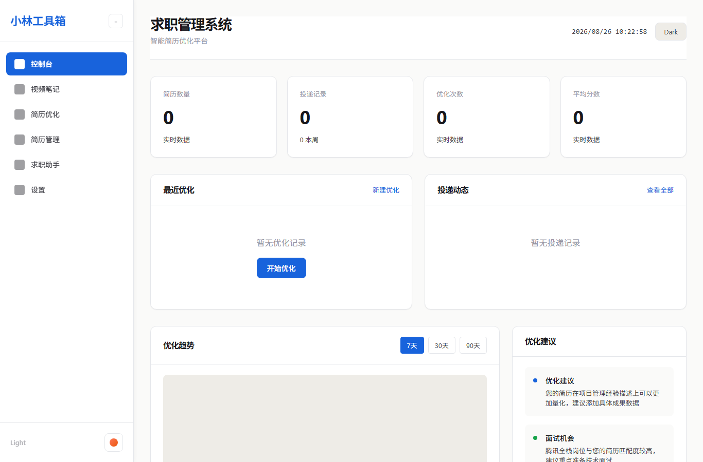
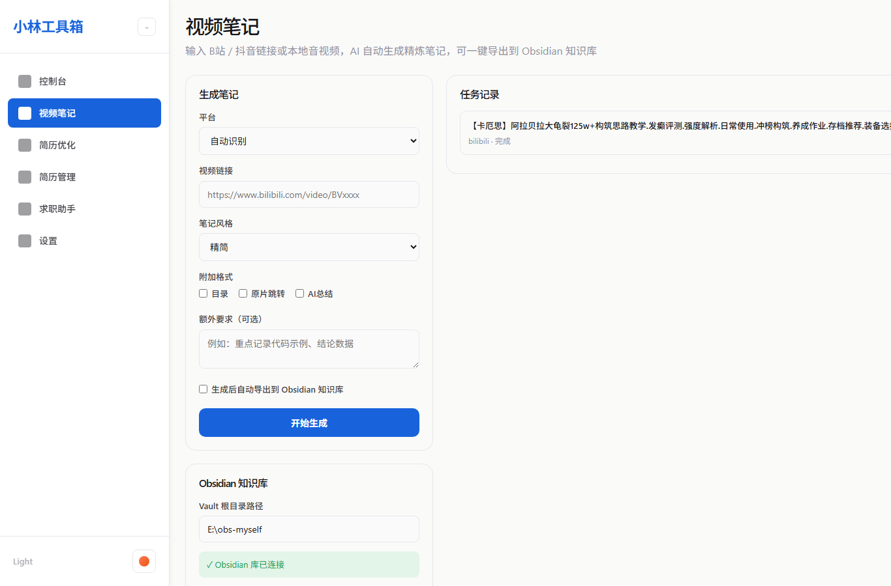
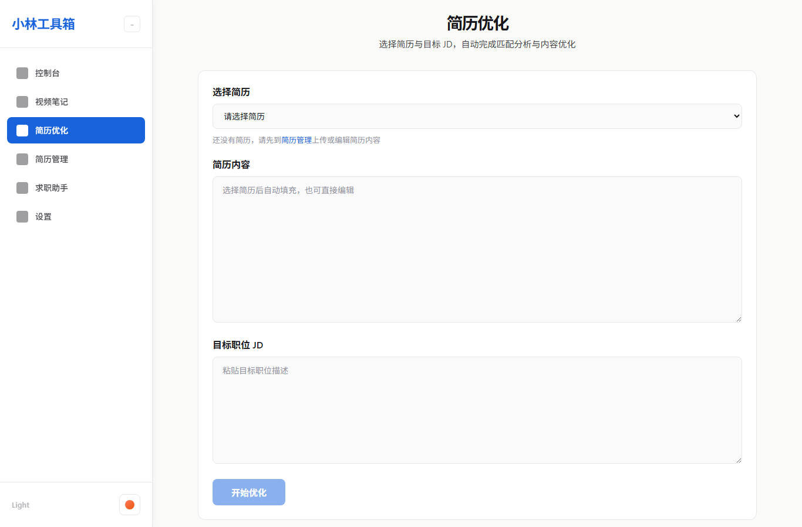
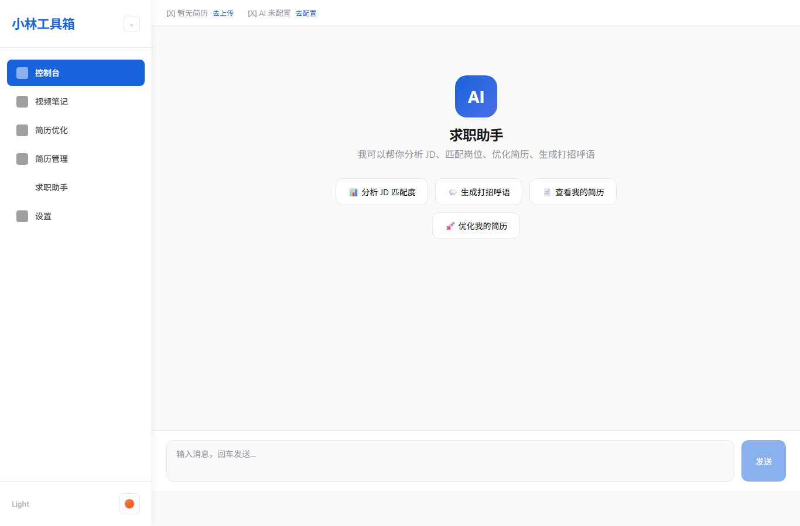

# 小林工具箱 - 多功能 AI 工具箱

基于多 Agent 协作系统的一站式 AI 效率工具箱（原 Job3.0），把简历优化、求职助手、知识问答、视频笔记整合到同一个工具里，替代多个独立工具的来回切换。

## 功能特性

- 🎬 **视频笔记（v2.0 新增）** - 粘贴 B站/抖音链接或选择本地音视频，自动完成 下载 → 转写 → AI 总结 → 导出 Obsidian 的完整流水线
- 🤖 **求职助手** - 多场景 Agent 工具集：知识问答 / JD 匹配 / 面试题生成 / 打招呼语
- 📊 **AI 简历优化** - LangGraph 多 Agent 自动反思优化：输入简历 + JD，输出多维度匹配分析与 STAR 法则改写稿
- 📄 **简历管理** - 多版本简历管理，快速切换与投递记录跟踪
- 🧩 **BOSS 海投记录助手（v2.1 新增）** - Edge 扩展一键记录 BOSS 职位到工具箱：URL 去重、JD 快照存档、打招呼语起草、打招呼后自动记录（AI 只起草、人工发送）
- ⚙️ **设置中心** - 配置 Obsidian Vault 路径、模型参数、Whisper 转写参数
- 🔧 **持续更新** - 更多功能陆续加入

## 界面预览

| 控制台 | 视频笔记 |
| :---: | :---: |
|  |  |
| AI 简历优化 | 求职助手 |
|  |  |

## 技术栈

### 前端
- Vue 3 + Vite
- Vite
- Pinia (状态管理)
- Axios (HTTP客户端)

### 后端
- FastAPI
- SQLAlchemy
- LangGraph / LangChain (多Agent框架)
- DeepSeek / OpenAI API

### 视频笔记
- yt-dlp (音视频下载)
- faster-whisper (本地语音转写)
- FFmpeg (音频抽取)

### 部署
- Docker & Docker Compose
- Nginx
- GitHub Actions (CI/CD)

## 快速开始

### 1. 克隆项目
```bash
git clone https://github.com/VIliyy/job3.0.git
cd job3.0
```

### 2. 配置环境变量
```bash
cd backend
cp .env.example .env
# 编辑 .env 填写 API Key（DeepSeek / OpenAI 至少配置一个）
```

### 3. 启动开发服务

**后端:**
```bash
cd backend
pip install -r requirements.txt
uvicorn app.main:app --reload
```

**前端:**
```bash
cd frontend
npm install
npm run dev
```

### 4. 视频笔记前置依赖
- **FFmpeg**：必须安装并加入 PATH（用于抽取音频）
- **Whisper 模型**：首次转写时自动下载（默认 tiny，约 75MB），国内网络可设置镜像：
  ```powershell
  $env:HF_ENDPOINT = "https://hf-mirror.com"
  $env:HF_HUB_DISABLE_XET = "1"
  ```

### 5. Docker部署 (生产环境)
```bash
docker-compose up -d
```

## 项目结构

```
job3.0/
├── frontend/           # 前端项目
│   ├── src/
│   │   ├── components/  # Vue组件
│   │   ├── views/       # 页面视图（控制台 / 视频笔记 / 求职助手 / 简历优化 / 简历管理 / 设置）
│   │   ├── stores/      # Pinia状态
│   │   ├── api/         # API封装
│   │   └── router/      # 路由
│   └── ...
│
├── backend/            # 后端项目
│   ├── app/
│   │   ├── api/        # API路由（含 video_notes.py）
│   │   ├── core/       # 核心配置
│   │   ├── models/     # 数据库模型（含 video_task.py）
│   │   ├── schemas/    # Pydantic模型
│   │   ├── services/   # 业务逻辑
│   │   │   └── video/  # 视频笔记流水线（下载/转写/总结/Obsidian导出）
│   │   └── agents/     # AI Agent（LangGraph / LangChain）
│   └── tests/          # 测试文件
│
├── docs/screenshots/   # 界面截图
├── docker-compose.yml  # Docker编排
├── nginx.conf          # Nginx配置
├── Dockerfile          # 后端镜像
└── .env.example        # 环境变量示例
```

## 开发指南

### 前端开发
```bash
# 类型检查
npm run type-check

# 代码检查
npm run lint

# 代码格式化
npm run format

# 运行测试
npm run test

# 构建生产版本
npm run build
```

### 后端开发
```bash
# 运行测试
pytest tests/ -v

# 测试覆盖率
pytest tests/ --cov=app --cov-report=html

# API文档
# 访问 http://localhost:8000/docs
```

## API文档

启动后端服务后访问：
- Swagger UI: http://localhost:8000/docs
- ReDoc: http://localhost:8000/redoc

## 环境变量说明

| 变量名 | 说明 | 必填 |
|--------|------|------|
| DEEPSEEK_API_KEY | DeepSeek API Key | 是 |
| OPENAI_API_KEY | OpenAI API Key | 否 |
| OLLAMA_BASE_URL | Ollama 本地模型地址 | 否 |
| OLLAMA_MODEL | Ollama 本地模型名 | 否 |
| LLM_API_KEY / LLM_BASE_URL / LLM_MODEL | 视频笔记专用 LLM（不配置则按 OPENAI > DeepSeek > Ollama 优先级） | 否 |
| WHISPER_MODEL_SIZE | Whisper 模型大小（tiny/base/small/medium/large-v3） | 否 |
| WHISPER_DEVICE | 转写设备（auto/cpu/cuda） | 否 |
| DATABASE_URL | 数据库连接URL | 否 |
| SECRET_KEY | JWT密钥 | 生产必填 |

## 视频笔记模块

把 B站 / 抖音链接或本地音视频自动转成精炼 Markdown 笔记，支持一键导出到本地 Obsidian 知识库。

### 使用流程
1. 侧边栏进入 **视频笔记**
2. 粘贴 B站/抖音链接，或选择本地音视频文件
3. 选择笔记风格（精简/详细/教程/会议纪要等）与附加格式（目录/原片跳转/AI总结）
4. 勾选「导出到 Obsidian」可自动把笔记写入知识库（需先在设置页配置 Vault 路径）
5. 后台流水线：**下载（yt-dlp）→ 转写（faster-whisper）→ AI 总结（LLM）→ 导出**

### 技术说明
- 前端：`frontend/src/views/VideoNotes.vue`（路由 `/video-notes`）
- 后端：`backend/app/services/video/`（下载/转写/总结/Obsidian 导出）
- 数据表：`video_tasks`（SQLite 自动创建）
- 状态流转：PENDING → PARSING → DOWNLOADING → TRANSCRIBING → SUMMARIZING → OBSIDIAN → SUCCESS/FAILED

## 贡献指南

1. Fork 本仓库
2. 创建特性分支 (`git checkout -b feature/amazing-feature`)
3. 提交更改 (`git commit -m "Add some amazing feature"`)
4. 推送到分支 (`git push origin feature/amazing-feature`)
5. 创建 Pull Request

## License

MIT License

## BOSS 海投记录助手（Edge 扩展，本地桥接）

- 后端新增 /api/bridge/*：健康检查、简历列表、投递记录（按 job_url 去重 + JD 快照 + 打招呼语生成）、最近记录查询与删除；除 /health 外均要求请求头 X-Bridge-Token（默认 job3-bridge-local-2026，见 ackend/.env.example）
- 数据表：job_snapshots（JD 原文与打招呼文稿存档，投递记录复用 pplications 表，带 job_url/source）
- 扩展源码在 dge-bridge/（MV3），安装与使用说明见 dge-bridge/README.md；安全模式：AI 只起草，发送动作由人工在 BOSS 内完成
